<a href="https://sachin-shell.vercel.app">
  <picture>
    <source media="(prefers-color-scheme: dark)" srcset="./assets/terminal-dark.svg">
    <source media="(prefers-color-scheme: light)" srcset="./assets/terminal-light.svg">
    
  </picture>
</a>

<p align="center">
  <a href="https://sachin-shell.vercel.app"></a>
  <a href="https://linkedin.com/in/sachinkr7368"></a>
  <a href="https://x.com/sachintwtss"></a>
  <a href="mailto:sachin7368kr@gmail.com"></a>
</p>

```console
❯ cat about.txt
```

I own the interface in front of money: hosted checkout, white-label merchant dashboards and the design systems under them, from Figma to production. Four years across cross-border payments, embedded wallets and AI.

<table>
  <tr>
    <td align="center" width="25%"><h1>-20%</h1><sub>checkout drop-off</sub></td>
    <td align="center" width="25%"><h1>-40%</h1><sub>API latency, better vitals</sub></td>
    <td align="center" width="25%"><h1>+30%</h1><sub>faster UI via the design system</sub></td>
    <td align="center" width="25%"><h1>-60%</h1><sub>manual entry, asset tagging</sub></td>
  </tr>
</table>

```console
❯ git log --oneline --career
```

```diff
+ 2026 ─ now   Product Engineer      @ Glomo           checkout · dashboards · theming
! 2025 ─ 2026  Frontend Engineer     @ Qurios AI       remote
! 2022 ─ 2025  Frontend Developer    @ Settlrs         embedded wallets, web3
# 2022         Full Stack Trainee    @ Newton School   where it started
```

```console
❯ ls ~/side-quests --sort=fun
```

<table>
  <tr>
    <td width="50%" valign="top">
      <h3><a href="https://github.com/sachinkr7368/garnet">💎 garnet</a></h3>
      A free, open-source Ruby &amp; Rails IDE for macOS. RubyMine-style flow, no account, no telemetry.<br><br>
      <code>Rust</code> <code>Tauri</code> <code>TypeScript</code>
      &nbsp;·&nbsp; <a href="https://github.com/sachinkr7368/garnet/releases/latest">download</a>
    </td>
    <td width="50%" valign="top">
      <h3><a href="https://github.com/sachinkr7368/aperio">📘 aperio</a></h3>
      Free OpenAPI docs engine: interactive reference, try-it client, samples in 10 languages, A–F linter, mocks, spec diff.<br><br>
      <code>Next.js 16</code> <code>React 19</code> <code>Tailwind</code>
      &nbsp;·&nbsp; <a href="https://aperio-nine.vercel.app">live</a>
    </td>
  </tr>
  <tr>
    <td width="50%" valign="top">
      <h3><a href="https://github.com/sachinkr7368/retainersnap">📊 retainersnap</a></h3>
      Monthly branded client reports for Framer, Webflow and Next.js retainers.<br><br>
      <code>Next.js</code> <code>TypeScript</code>
      &nbsp;·&nbsp; <a href="https://retainersnap.vercel.app">live</a>
    </td>
    <td width="50%" valign="top">
      <h3><a href="https://github.com/sachinkr7368/pathly">🧭 pathly</a></h3>
      An AI career OS for students and professionals.<br><br>
      <code>Next.js</code> <code>TypeScript</code> <code>LLMs</code>
      &nbsp;·&nbsp; <a href="https://pathly-mu-nine.vercel.app">live</a>
    </td>
  </tr>
  <tr>
    <td width="50%" valign="top">
      <h3><a href="https://github.com/sachinkr7368/xray-debugger">🩻 xray-debugger</a></h3>
      A library + dashboard for debugging multi-step, non-deterministic systems. Tracing shows <i>what</i> happened; X-Ray shows <i>why</i>.<br><br>
      <code>Next.js 15</code> <code>TypeScript</code> <code>shadcn/ui</code>
    </td>
    <td width="50%" valign="top">
      <h3><a href="https://github.com/sachinkr7368/jsontreevisualizer">🌳 json-tree</a></h3>
      Paste JSON, get a zoomable React Flow tree with JSONPath search and click-to-copy paths.<br><br>
      <code>Next.js</code> <code>React Flow</code>
      &nbsp;·&nbsp; <a href="https://jsontreevisualizer-pearl.vercel.app">live</a>
    </td>
  </tr>
</table>

```console
❯ cat skills.txt
```

<p align="center">
  
</p>

<sub><b>domain</b> &nbsp; checkout · white-label UI · multi-tenant theming · KYC · Stripe · Privy · web3 &nbsp;|&nbsp; <b>workflow</b> &nbsp; Claude Code · Cursor, used to ship faster, never to skip the thinking</sub>

```console
❯ ./contributions --eat
```

<picture>
  <source media="(prefers-color-scheme: dark)" srcset="https://raw.githubusercontent.com/sachinkr7368/sachinkr7368/output/snake-dark.svg">
  <source media="(prefers-color-scheme: light)" srcset="https://raw.githubusercontent.com/sachinkr7368/sachinkr7368/output/snake.svg">
  
</picture>

<p align="center"><sub>❯ <code>exit</code> &nbsp;·&nbsp; the full interactive version lives at <a href="https://sachin-shell.vercel.app">sachin-shell.vercel.app</a></sub></p>
